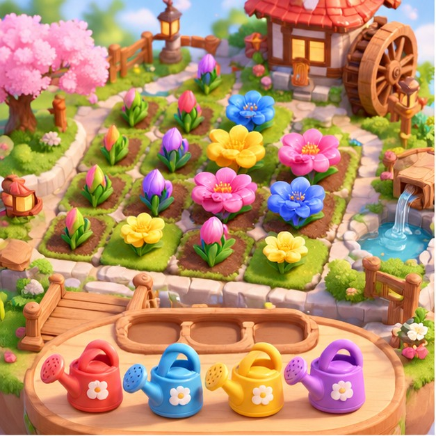
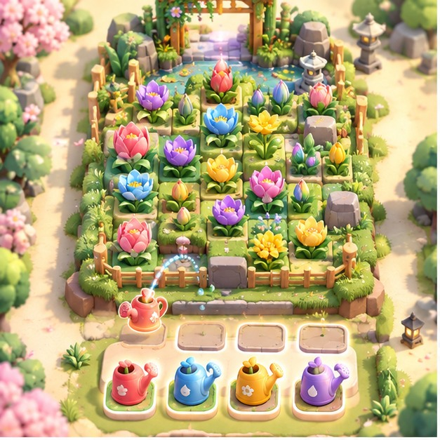
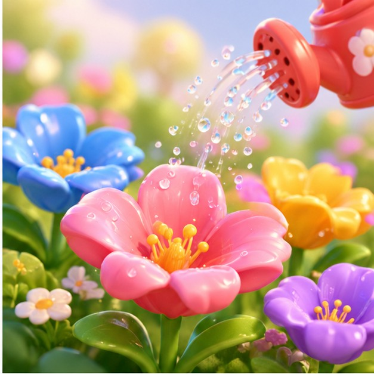
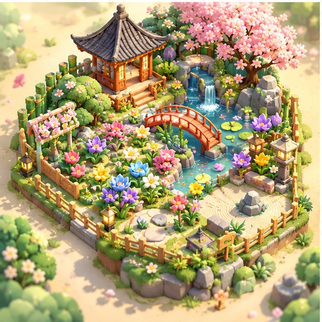
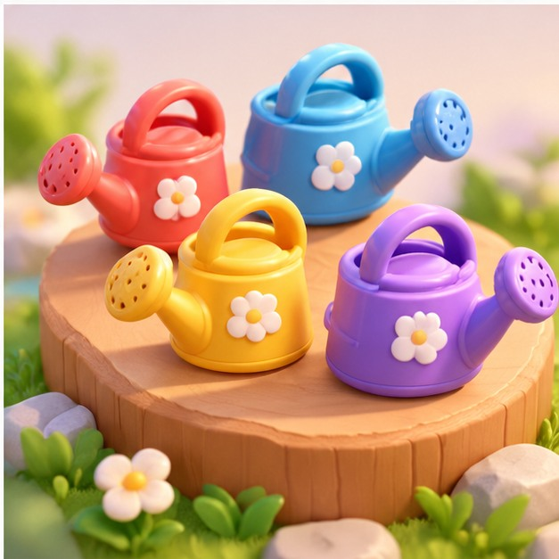
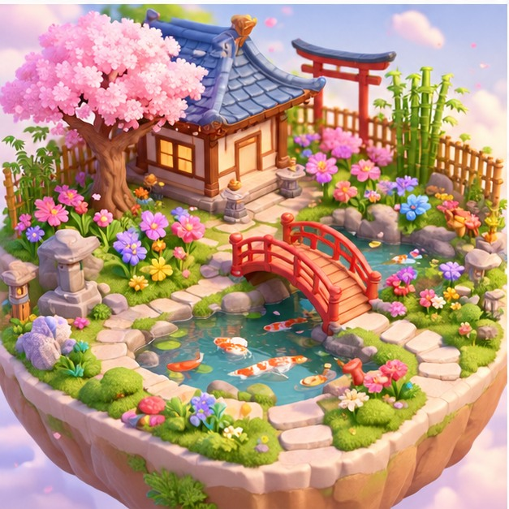
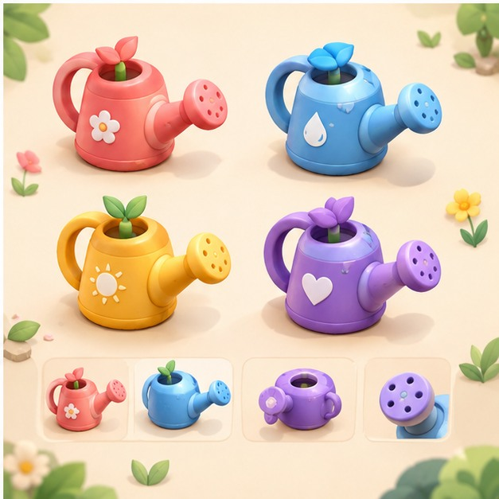

<div class="cover">
  <div class="eyebrow">DOSSIER DE PRODUCTION • VERSION 1.0 • 12 OCTOBRE 2026</div>
  <h1>BLOOM<br>GARDEN</h1>
  <p class="subtitle">Game Design Document + plan d'exécution<br>Jeu mobile de réflexion relaxant en 2,5D</p>
  
  <div class="cover-foot">Android + iOS · Unity 6 · Portrait · Sans limite de temps · Codex / Claude Code</div>
</div>

<div class="page-break"></div>

# 01 — Résumé exécutif

**Promesse :** « Choisis le bon arrosoir, laisse les fleurs éclore et révèle un jardin magnifique. » Bloom Garden est un jeu de réflexion mobile en portrait. Le joueur libère des arrosoirs de files, gère un nombre limité d'emplacements, et observe automatiquement les boutons floraux s'ouvrir selon leur couleur. Aucun chronomètre, aucun adversaire, aucune nécessité de réflexes.

**Ce document est la source de vérité.** Il contient les règles impératives du prototype, les propositions facultatives pour plus tard, le périmètre technique, les étapes de livraison et les critères permettant de comparer équitablement Codex et Claude Code. Chaque décision nouvelle doit être consignée dans `docs/DECISIONS.md` par l'agent, sans modifier silencieusement les règles verrouillées.

| Paramètre | Décision de départ |
|---|---|
| Genre | Puzzle logique relaxant, solo, accessible, « one tap » |
| Moteur | Unity 6 ou supérieur, projet URP 3D léger, caméra orthographique 2,5D |
| Cibles | Android d'abord ; architecture compatible iOS |
| Orientation | Portrait 9:16, adaptable aux autres ratios et aux encoches |
| Interaction | Tap pour envoyer un arrosoir ; arrosage automatique |
| Timer | Aucun ; pas de dégâts, de combats ou d'échecs liés au temps |
| Arrosoirs | Rouge/corail, bleu, jaune, violet ; capacité numérique |
| Places actives | 3 maximum, extensible par progression seulement après validation |
| Progression | 20 niveaux MVP, 50 en alpha, 100 avant test commercial |
| Monétisation | Exclue du MVP ; seulement après preuves de qualité et conformité |
| Référence d'ambiance | Jardin miniature, matériaux doux, animation d'éclosion |
| Propriété intellectuelle | Univers, assets, UI, sons, niveaux, titre originaux |

**Objectif du prototype :** prouver que le joueur comprend le système en moins de 45 secondes, ressent une satisfaction immédiate en regardant une séquence d'éclosion et souhaite lancer spontanément un autre niveau. Ce sont des hypothèses à mesurer, pas des résultats acquis.

> **Note de périmètre :** Le nom « Bloom Garden » est provisoire. Avant la publication, vérifier disponibilité du nom, marques, domaines et ressemblances de présentation avec les jeux concurrents. Les illustrations du présent dossier sont des concepts générés spécialement ; pas des captures d'un jeu fonctionnel et pas des assets finaux prêts à importer tels quels.

# 02 — Public, positionnement et piliers de l'expérience

**Public primaire :** joueurs de puzzles mobiles de 16 ans et plus, appréciant le raisonnement calme, les sessions de 2 à 8 minutes et les interactions simples. Le produit doit être assez clair pour d'autres tranches d'âge sans supposer d'autonomie de l'enfant vis-à-vis d'achats intégrés. Ne pas choisir de ciblage enfants avant une analyse de conformité complète.

**Trois piliers non négociables :**

1. **Décision réfléchie, résultat automatique.** Une pression de doigt produit une conséquence visible et agréable. Les erreurs viennent de l'ordre des choix, pas de la vitesse d'exécution.
2. **Transformation positive.** Chaque action fait éclore un jardin progressivement. La récompense visuelle raconte l'avancement sans devoir lire de texte.
3. **Challenge juste.** Tout niveau publié a une solution sans booster, vérifiée par un solveur, et le joueur peut revenir sur son dernier choix gratuitement.

**Ce que le jeu n'est pas :** un simulateur de jardinage réaliste, un match-3, un runner, un jeu idle automatisé de bout en bout, un clone visuel de Pixel Flow ou un Sudoku de chats. Les inspirations concernent la simplicité d'accès, la logique séquentielle et le plaisir de voir progresser une animation.

**Hypothèse commerciale :** le genre peut convenir à une acquisition via vidéos courtes, mais les téléchargements et revenus dépendront de tests de marché. Ne pas déduire une prévision de ventes du succès d'un concurrent.

# 03 — Direction artistique et références visuelles

<div class="image-pair">


</div>

**Style recherché :** diorama miniature haut de gamme, surfaces arrondies et lisibles, palette pastel contrastée, pas de textures photoréalistes. Environnement vivant mais jamais agité. L'effet premium vient des transitions, des sons discrets et de la cohérence graphique davantage que du nombre de polygones.

**Palette de départ :** corail `#EF7988`, bleu `#65AEE7`, jaune `#F5C55F`, violet `#AD91DF`, fond ivoire `#FFF9EE`, feuille `#6DBF93`, texte sombre `#25483B`. Chaque couleur de gameplay doit aussi posséder un motif ou symbole différenciant pour l'accessibilité.

**Règles de lisibilité :** une fleur non éclose et une fleur éclose doivent être distinctes par la forme, pas seulement par la teinte ; une action disponible utilise une surbrillance de contours ; un arrosoir qui attend doit afficher sa capacité restante ; les éléments décoratifs ne doivent pas masquer les cibles.

**Références conceptuelles — non contractuelles :**

<div class="image-pair">


</div>

# 04 — Boucle de jeu : comprendre en un regard

**Boucle primaire :** observer les fleurs visibles et la file → choisir un arrosoir accessible → l'envoyer dans l'une des trois places → le laisser arroser automatiquement les boutons de sa couleur → voir de nouveaux boutons apparaître → décider du coup suivant → faire éclore l'ensemble du jardin.

**Boucle méta :** terminer un niveau → récolter une étoile ou une graine cosmétique → déverrouiller un décor de jardin → voir l'album des jardins complétés → démarrer le niveau suivant. Pour le MVP, ne pas créer d'économie virtuelle complexe : victoire, sauvegarde et sélection de niveaux suffisent.

**Sensation cible de chaque tap :**

- 0–100 ms : feedback tactile et sonore léger sur l'arrosoir choisi.
- 100–500 ms : déplacement vers une place libre, avec trajectoire prévisible.
- 500–1 500 ms : premières gouttes, éclosions en chaîne et particules discrètes.
- Après séquence : tous les éléments se stabilisent, et l'utilisateur retrouve immédiatement le contrôle.

Ces durées sont des intentions d'animation **non bloquantes** ; elles ne constituent pas des délais imposés au raisonnement. Prévoir une option de vitesse des animations (normal / rapide) et « réduire les animations ».

# 05 — Modèle formel des règles MVP (verrouillé)

## 5.1 Plateau

Le plateau est une grille rectangulaire, initialement de 3 × 3 à 5 × 5 cases. Chaque case contient une pile ordonnée de **0 à 3 boutons floraux**. Seul le bouton supérieur non éclos est visible et ciblable. Quand un bouton éclot, il disparaît de l'ensemble des objectifs actifs et le suivant de la pile devient visible. Une case vide montre le gazon et/ou une décoration non interactive.

Chaque bouton possède `colorId` parmi `coral`, `blue`, `yellow`, `purple`. Deux boutons de couleurs identiques dans une même pile restent deux unités distinctes. Une fleur compte comme traitée lorsqu'elle a complètement reçu son unité d'arrosage logique, indépendamment du temps de l'animation.

## 5.2 Arrosoirs et files

Au bas de l'écran, **3 files indépendantes** affichent leurs arrosoirs de tête. Le joueur peut sélectionner le premier arrosoir d'une file non vide si une place d'arrosage est libre. Les arrosoirs derrière les premiers sont visibles partiellement, mais non sélectionnables. C'est le mécanisme d'encombrement de base, sans pathfinding de véhicules pour le MVP.

Un arrosoir possède `canId`, `colorId`, `capacity` entière strictement positive, et `remaining` initialisé à cette capacité. Chaque bouton arrosé consomme exactement **1** unité. Les arrosoirs ne rechargent pas pendant le niveau. Les capacités typiques du MVP : 1 à 5 ; des capacités plus élevées seront testées après validation du puzzle.

## 5.3 Places actives et arrosage automatique

Il existe **3 places d'arrosage**. L'arrosoir envoyé occupe la première place libre de gauche à droite. Une fois placé, il arrosera toutes les fleurs **actuellement visibles** de sa couleur, jusqu'à épuisement de sa capacité ou absence de cible compatible. S'il conserve de l'eau mais qu'aucune cible de sa couleur n'est visible, il **reste en attente et bloque sa place**.

Après chaque éclosion, le système vérifie à nouveau toutes les places occupées, car une fleur cachée peut être révélée. Lorsque `remaining == 0`, l'arrosoir quitte immédiatement sa place et devient « terminé ». Un arrosoir ne change jamais de couleur. Le joueur ne vise pas les fleurs et ne déplace pas manuellement les arrosoirs après sélection.

## 5.4 Arbitrage déterministe des cibles

Pour garantir des replays identiques et rendre le solveur fiable : lorsqu'un arrosoir a plusieurs cibles de sa couleur, il traite celle possédant la plus petite paire `(row, column)` (parcours de haut en bas puis de gauche à droite). Les places actives sont évaluées de la plus ancienne à la plus récente. À chaque étape logique, traiter **une fleur**, recalculer le dessus des piles et réévaluer les places. Les animations peuvent être différées, mais la simulation logique ne dépend jamais d'elles.

## 5.5 Gagner, bloquer, annuler

**Victoire :** toutes les piles de fleurs sont vides. Les arrosoirs non sélectionnés ne sont pas nécessairement tous utilisés : la règle de victoire porte sur les fleurs. **Blocage :** aucune fleur ne peut être arrosée par les arrosoirs actifs et les trois places sont occupées, alors qu'il reste des fleurs. Présenter alors « Réessayer » et « Annuler » ; jamais un compte à rebours.

**Annulation gratuite :** sauvegarder un instantané déterministe de l'état **avant chaque sélection**, puis le restaurer sur demande, au minimum jusqu'au début du niveau. L'annulation restaure aussi les compteurs, files et slots, et annule proprement toute animation en cours. Aucune publicité n'est nécessaire pour annuler dans le MVP.

**Cas de figure à éviter :** laisser le jeu afficher « vous avez perdu » quand les trois places sont encore occupées mais qu'une éclosion est programmée ; permettre d'envoyer deux fois le même arrosoir ; séparer l'état logique de l'état visuel sans synchronisation ; utiliser des temps d'animation pour décider si une fleur est accessible.

# 06 — Exemple pédagogique de niveau

**Niveau 01 : « Première floraison »** — 3 boutons `coral`, 3 boutons `blue`, 2 files contenant chacun un arrosoir de capacité 3 de la couleur correspondante. Le joueur choisit librement les deux : succès immédiat. Ce niveau enseigne « toucher → mouvement → arrosage automatique ».

**Niveau 04 : « Couleurs cachées »** — les boutons `coral` cachent des `blue` ; un arrosoir `blue` envoyé trop tôt reste en attente. Le niveau reste résoluble en exploitant les 3 places, mais le joueur découvre le lien entre couches et ordre.

**Niveau 10 : « Place précieuse »** — plusieurs arrosoirs de mauvaise couleur visibles peuvent occuper les places sans faire progresser le jardin. Le joueur apprend qu'il doit lire le dessus du plateau et anticiper le prochain bouton révélé.

**Remarque :** les exemples textuels ci-dessus décrivent des intentions pédagogiques. Les données numériques définitives doivent être générées, passées au solveur et vérifiées dans Unity. Les fichiers `levels/` de ce dossier contiennent des exemples de contrat de données et un lot de niveaux de départ vérifiés par le solveur de référence ; ils ne constituent pas encore un équilibrage humain final.

# 07 — Parcours UX / écrans du jeu

**Écran A : accueil.** Nom, diorama vivant, bouton « Jouer », icônes son/paramètres ; éviter les carrousels promotionnels. **Écran B : niveaux.** Thèmes sous forme de petits îlots floraux, niveau actuel bien mis en évidence. **Écran C : partie.** Haut : objectif et compteur de fleurs ; centre : plateau ; milieu-bas : 3 places ; bas : trois files et bouton Annuler. **Écran D : victoire.** Gros plan sur jardin terminé, récompense légère, « Suivant » prédominant et « Rejouer » secondaire. **Écran E : paramètres.** Son, musique, vibration, vitesse des animations, contraste, confidentialité.

**Safe area mobile :** éviter les encoches, barres de navigation et zones courbes ; marges UI dynamiques ; ne pas placer les cibles essentielles sous le pouce sans zone tactile suffisante. Taille physique visée pour les boutons principaux : au moins 44–48 points logiques équivalents ; vérifier sur appareil réel.

**Séquençage des écrans au prototype :** jeu → victoire → suivant → pause/paramètres ; accueil et choix de niveau simplifiés suffisent. Ne pas coder un écran boutique au MVP.

**Wireframe logique de l'écran portrait :**

<div class="wireframe">
 <div class="wf-top">NIVEAU 12 <span>FLEURS 14/25</span> <span>⚙</span></div>
 <div class="wf-board"><div class="wf-board-title">JARDIN / PILES DE BOUTONS</div><div class="wf-flowers">✿ 🌷 ✿ 🌷 ✿<br>🌷 ✿ 🌷 ✿ 🌷<br>✿ 🌷 ✿ 🌷 ✿<br>🌷 ✿ 🌷 ✿ 🌷</div></div>
 <div class="wf-note">Automatique : les fleurs éclosent une par une</div>
 <div class="wf-slots"><div>PLACE 1</div><div>PLACE 2</div><div>PLACE 3</div></div>
 <div class="wf-bottom"><div>ROUGE<br>3</div><div>BLEU<br>4</div><div>JAUNE<br>2</div></div>
 <div class="wf-actions">↶ ANNULER &nbsp;&nbsp;&nbsp; RECOMMENCER</div>
</div>

**Attention :** la grille, les places et les files doivent rester parfaitement identifiables même avec un décor plus ambitieux. Les fleurs décoratives hors plateau ne doivent jamais ressembler à des cibles interactives.

# 08 — Tutoriel et progressivité de la difficulté

| Niveaux | Notion principale | Contraintes |
|---|---|---|
| 1–3 | Tap, couleurs, éclosion automatique | 2 couleurs, 1 couche, choix faciles |
| 4–6 | Fleurs cachées dans les piles | 2–3 couleurs, couches 2 |
| 7–10 | Gestion des 3 places et files | 3 couleurs, faux choix possibles |
| 11–20 | Anticiper plusieurs coups | 3–4 couleurs, 2–3 couches |
| 21–35 (après MVP) | Files plus longues / blocs de couleurs | 4 couleurs, combinaisons variées |
| 36–50 (après MVP) | Puzzles experts accessibles | Variations scénarisées validées |

**Niveau difficile ≠ niveau lent :** plus de boutons ne suffit pas à créer un bon challenge. Valoriser la lisibilité des conséquences : choix crédibles, moments de révélation, pièges compréhensibles et solution démontrable. Ne pas fabriquer des blocages artificiels pour pousser à acheter un booster.

**Courbe de difficulté :** alterner niveau de découverte, consolidation, léger challenge, niveau plus facile de récupération. Après un niveau difficile, offrir une scène visuellement spectaculaire et relativement simple.

**Indicateurs à collecter à partir de l'alpha :** temps médian pour comprendre le tutoriel ; taux de victoire par niveau ; médiane d'annulations ; échecs/abandons par niveau ; niveaux où le joueur relance sans incitation ; retour J1/J7. Les seuils commerciaux doivent être adaptés aux observations et non fixés comme des vérités universelles.

# 09 — Génération de niveaux et solveur automatique

Le projet doit comporter un **solveur déterministe indépendant des animations Unity**. Il sert de garde-fou : aucun niveau aléatoire ou éditorial ne peut être marqué « publiable » si le solveur ne trouve pas de solution sans pouvoir payant.

**Contrat du solveur :** entrée = `LevelDefinition` versionné ; sortie = `solvable`, chemin de choix de files, nombre d'états explorés, profondeur minimale, éventuels avertissements (trivialité, longues attentes, forte ambiguïté). Utiliser BFS pour les petits niveaux et un algorithme mémorisé / heuristique pour les instances plus grandes. Toute heuristique non exhaustive doit être identifiée comme telle.

**Générateur :** générer d'abord un plateau et un inventaire d'arrosoirs conservant la quantité totale de fleurs par couleur. Distribuer ensuite les arrosoirs dans 3 files, exécuter le solveur, rejeter toute instance insolvable, puis scorer la difficulté sur la profondeur de solution, la quantité de choix trompeurs et le nombre d'états raisonnables. Un niveau validé mathématiquement passe ensuite une **revue visuelle et humaine**.

**Invariant :** avec un arrosoir de charge X, on peut traiter X fleurs au plus. La somme des capacités de tous les arrosoirs d'une couleur doit être au moins égale au nombre de fleurs de cette couleur ; dans les niveaux de référence, elle est égale pour éviter toute ambiguïté. Pour produire des niveaux plus intéressants, on peut autoriser plus tard un surplus documenté.

**Protection contre une explosion combinatoire :** limiter le nombre de boutons actifs et de files pour le prototype, mémoriser les états visités et fixer des plafonds d'exploration. Une réponse « inconnu car limite atteinte » n'est jamais une preuve de solvabilité.

**Validation des données :** chaque niveau comporte une version de règles, un identifiant stable, une taille de grille, les piles par case, les 3 files d'arrosoirs, les capacités et les paramètres de présentation. Vérifier identifiants uniques, couleurs autorisées, capacités entières, coordonnées et conservation des ressources.

# 10 — Architecture Unity recommandée

**Moteur :** Unity 6 LTS si disponible sur le PC, URP adapté au mobile, scène orthographique, cibles 60 FPS sur appareil de référence (avec mode dégradé 30 FPS). C# avec séparation du modèle logique et de la présentation. Éviter que l'animation décide des règles.

**Organisation proposée :**

```text
Assets/_BloomGarden/
  Art/                 # sprites, modèles, matériaux autorisés
  Audio/               # SFX et musiques avec preuve de licence
  Prefabs/             # FlowerBud, WateringCan, Slot, HUD
  Scenes/              # Boot, MainMenu, Game, LevelSelect
  Scripts/
    Core/              # LevelModel, GameState, TurnResolver
    Levels/            # LevelDefinition, loader, validator
    Solvers/           # LevelSolver, replay
    Presentation/      # FlowerView, CanView, VFXController
    UI/                # HUD, VictoryPanel, Settings
    Services/          # SaveService, AudioService, Analytics
  ScriptableObjects/
  Settings/
  Tests/EditMode/
  Tests/PlayMode/
Docs/                   # ADR, décisions, essais, captures
Builds/                 # Ignorer via git, sauf manifest descriptif
```

**Principes :** `GameState` est un objet de données sérialisable et testable sans scène ; `TurnResolver` applique un choix puis les éclosions ; la présentation reçoit des événements (`CanSelected`, `FlowerBloomed`, `CanEmptied`, `Win`, `Deadlock`) ; chaque événement transporte des identifiants stables. Une couche orchestratrice séquence les animations mais ne change pas la logique.

**UI :** choisir **UI Toolkit** pour les interfaces de menu et superpositions lorsque l'équipe maîtrise le flux et que cela répond aux contraintes visuelles ; on peut utiliser de l'UI en canvas classique pour des superpositions simples si c'est plus stable. Documenter le choix et ne pas mélanger plusieurs frameworks sans justification. Unity recommande UI Toolkit pour les nouveaux projets ; le plugin Unity fournit les compétences correspondantes.

**Sauvegarde :** progression par identifiants de niveau, options utilisateur, version de sauvegarde et dernier niveau accessible. Prévoir migration. Une sauvegarde cassée ne doit pas effacer silencieusement tous les progrès ; copier l'état précédent et afficher une erreur récupérable.

# 11 — Assets 3D, animations et effets de qualité

<div class="image-pair">


</div>

**MVP :** géométrie simple produite dans Unity ou Blender : carrés arrondis pour parcelles, 4 arrosoirs stylisés, 4 bourgeons, 4 fleurs ouvertes, clôture, pierres, gazon, fontaine facultative. Préférer un petit ensemble cohérent à des dizaines d'assets hétérogènes.

**Animation de fleur recommandée :** (1) petite impulsion des feuilles, (2) goutte d'eau, (3) gonflement de la tige, (4) ouverture des pétales avec léger décalage, (5) scintillement discret. Le jeu doit rester lisible en vitesse accélérée ou « animations réduites ». Ne pas bloquer le déclenchement du tour suivant pour toute la durée de la célébration.

**Animation d'arrosoir :** anticipation (5 % de rebond), trajectoire courte courbe vers le slot, inclinaison au début du jet, particules regroupées, petit son de liquide, animation de sortie quand vide. Si l'arrosoir attend, une respiration légère plutôt qu'un mouvement agressif.

**Qualité technique :** limiter transparences superposées et particules coûteuses, utiliser instancing ou pools, profiler avec le téléphone de référence, vérifier la lisibilité sur un petit écran et avec le mode contraste élevé. Les fichiers JPEG de moodboard sont des **références d'intention** ; ils ne doivent pas être placés dans une scène comme textures finales par défaut.

# 12 — Audio, confort et accessibilité

**Audio :** petite pluie musicale facultative, aucune alerte anxiogène, SFX différenciés pour sélection, arrosage, éclosion, slot occupé, erreur et victoire. Un échec produit un son discret ; éviter les sons stridents, les jingles répétés et les vibrations involontaires.

**Paramètres obligatoires avant bêta :** musique on/off, SFX on/off, vibration on/off, vitesse d'animation 1x/2x, animations réduites, contrastes de couleur, accès facile à « Annuler » et « Recommencer ». Traductions initiales FR et EN ; architecture capable d'ajouter d'autres langues et support de polices accentuées.

**Accessibilité :** ne jamais coder la couleur comme unique indice ; ajouter forme/motif pour chaque couleur, étiquettes pour capacité restante et réponses visuelles aux touches. Test de contraste et daltonisme. Tap targets ≥44 px logiques / unité équivalente selon système utilisé ; valider sur téléphone réel.

**Pause :** possible à tout moment entre les choix ou pendant une animation ; état déterministe. Le retour d'arrière-plan ne doit pas laisser le jeu sur un état intermédiaire.

# 13 — Méta-progression et jardins collectionnables

**MVP :** progression linéaire, sauvegarde automatique, écran des 20 niveaux, récompense de fin de niveau. **Alpha :** quatre thèmes de cinq niveaux (Prairie, Étang, Crépuscule, Japon). Chaque thème peut avoir un petit changement de décor, pas une refonte de règles.

**Après validation :** jardin japonais, jardin tropical, nocturne, alpin, fantastique. Déblocages cosmétiques visibles dans un album. Aucun jardin ne doit cacher une règle essentielle derrière un paiement.

<div class="image-pair">


</div>

**Enrichissement durable :** nouveau type de fleur, scénario de puzzle inédit, petits objectifs journaliers facultatifs, album de jardins ; ne pas lancer une « guerre de contenu » où l'IA génère des milliers de niveaux peu intéressants.

# 14 — Économie, publicité et achats intégrés : après le MVP

**Principe éditorial :** aucun écran commercial dans les trois premiers niveaux ; ne jamais rendre un niveau mathématiquement insoluble pour vendre une solution. Les indices facultatifs et options de confort peuvent être monétisés uniquement si le jeu reste complet sans paiement.

**Pistes à tester après validation :** publicité récompensée pour obtenir un indice optionnel ; offre payante pour retirer les publicités interstitielles si elles sont ensuite introduites ; packs de styles de jardins ; thèmes cosmétiques. Ne pas monétiser l'annulation de base.

**Priorité qualité :** ne pas intégrer AdMob, médiation, achats intégrés et analytics complexes avant d'avoir prouvé la boucle de jeu. Lors des intégrations, utiliser les environnements de test, gestion des consentements adaptée aux territoires et déclarations de données collectées à jour. Les règles des plateformes peuvent changer : contrôler les documents officiels au moment de la publication.

**Budgets :** publicité de test disponible 300–500 €/mois selon la décision du propriétaire ; ne jamais dépenser ou lancer une campagne sans validation explicite. Aucun chiffre de revenus du présent dossier n'est une garantie.

# 15 — Instrumentation et décisions fondées sur les données

Événements recommandés (avec schéma de propriétés stable) :

| Événement | Propriétés utiles | Question à résoudre |
|---|---|---|
| `level_started` | level_id, variant, session_id | Combien commencent chaque niveau ? |
| `can_selected` | level_id, lane, color, cap | Quels choix font les joueurs ? |
| `undo_used` | level_id, turn_index | Quand reviennent-ils en arrière ? |
| `deadlock_detected` | level_id, used_slots | Quels niveaux frustrent ? |
| `level_completed` | level_id, steps, duration | Où réussissent-ils ? |
| `level_abandoned` | level_id, last_state_hash | Où abandonnent-ils ? |
| `settings_changed` | setting_name | Animations jugées trop lentes ? |

**Confidentialité :** identifiants pseudonymes si analytics tiers, aucun nom ni contact nécessaire au gameplay, minimisation des données. Pas d'identifiant publicitaire dans le prototype. Prévoir des parcours hors-ligne et sans consentement marketing.

**Données de test :** journal technique local lisible lors du développement et télémétrie réelle uniquement après paramétrage correct. Les rétentions J1/J7 ne doivent pas être calculées à partir de simples sessions internes des développeurs.

# 16 — Tests automatisés indispensables

**EditMode (logique pure) :**

1. Sélection d'une file vide impossible, sans altération d'état.
2. Capacité nulle ou négative rejetée au chargement.
3. Un arrosoir n'arrose jamais une couleur différente.
4. Les boutons cachés ne peuvent pas être ciblés avant révélation.
5. Séquence d'arrosage déterministe quel que soit le FPS.
6. L'arrosoir se retire lorsqu'il atteint zéro.
7. L'arrosoir qui n'a plus de cible reste dans sa place.
8. Les trois places occupées empêchent un quatrième départ.
9. Après révélation d'un bouton, les arrosoirs en attente sont réévalués.
10. Une annulation restitue exactement l'état antérieur (hash identique).
11. Victoire seulement si tous les boutons sont fleuris.
12. Bloqué seulement après stabilisation des événements logiques.
13. Chargement d'un fichier JSON mal formé échoue proprement.
14. Tous les niveaux validés ont une solution garantie par le solveur.
15. Un replay d'une solution produite par le solveur termine le niveau.

**PlayMode (Unity) :**

- Charger le niveau 1, jouer la solution, observer le panneau de victoire.
- Sauvegarder, quitter, relancer, reprendre au bon niveau.
- Changer d'orientation système : l'application conserve le portrait.
- Changer FR/EN : aucun texte ne déborde sur petits écrans.
- Spam de taps pendant animation : aucune sélection doublée.
- Mettre en pause / passer en arrière-plan au milieu d'une éclosion.
- Réduire les animations sans altérer les résultats.
- Simuler une donnée erronée sans crash ni perte de sauvegarde.

**Validation manuelle de départ :** cinq personnes n'ayant jamais vu le jeu ; observation sans explication pendant 10 minutes, prises de notes sur la compréhension et la lisibilité. Puis 20 à 30 personnes si le prototype est prometteur. Ces tailles servent à trouver des défauts d'usage, pas à établir une rétention statistiquement robuste.

# 17 — Performance, appareils et qualité mobile

**Critères cibles :** 60 FPS sur téléphone de référence récent avec les effets par défaut ; 30 FPS stable sur appareil Android milieu de gamme plus ancien après réduction d'effets ; pas de freeze visible lors d'une séquence de 50 éclosions. Les budgets CPU/GPU/mémoire sont à mesurer après premier build, pas à inventer.

**Appareils :** au moins un Android physique de référence + un Android moins performant pour la bêta ; sur iOS, un iPhone physique via machine macOS ou service build compatible. Test hors-ligne, mode économie d'énergie, changement langue, mise en veille, reprise, perte de stockage et encoches.

**Qualité de livraison :** aucune exception Unity persistante en console lors du parcours normal ; aucune erreur de compilation ; pas de dépendance commerciale non documentée ; assets sans licences ambiguës ; captures de tests enregistrées dans `Docs/QA/`.

# 18 — Cadence de travail et jalons (sans calendrier irréaliste)

| Phase | Livrable principal | Critère de sortie |
|---|---|---|
| P0 : cadrage | Projet Unity, dépôt Git, règles signées | Ouvre, compile, documentation exacte |
| P1 : cœur logique | Moteur pur C#, états et tests | Tests invariants 100 % verts |
| P2 : solveur / niveaux | Solveur + 20 fichiers | Chaque niveau solvable + replay |
| P3 : vertical slice | Scène portrait jouable + 4 arrosoirs | Partie complète, sans assets définitifs |
| P4 : sensation premium | VFX éclosion, sons, UI lisible | 5 personnes comprennent le jeu |
| P5 : alpha 20 niveaux | Sauvegarde, options, équilibrage | Test Android réel sans crash bloquant |
| P6 : bêta élargie | 50–100 niveaux sélectionnés | Données de jeu et feedback documentés |
| P7 : conformité / monétisation | Contrôle privacy, stores, pubs facultatives | App review interne OK |
| P8 : lancement limité | Store, créas, tests publicitaires | Décision de poursuivre basée sur KPI |

**Durées de planification indicative, pas des engagements :** 1–2 semaines pour une démonstration jouable simple avec un environnement bien configuré et des outils IA efficaces ; 6–12 semaines pour une bêta sérieuse à temps partiel si les assets, les tests et les itérations ne dérivent pas. Une application commercialisable peut prendre plus longtemps.

**Règle de pilotage :** l'agent ne doit jamais considérer le projet terminé parce que le prompt initial a été exécuté. À chaque fin de phase, il doit publier preuves, tests, capture vidéo/écran si possible, risques, limitations et plan de phase suivante. L'utilisateur approuve explicitement le passage aux étapes payantes ou de publication.

# 19 — Définition de « terminé » par phase

**P1 terminé :** le projet Unity contient des classes de modèle testables, exécute la logique sans scène et passe la batterie EditMode ; les classes essentielles ne dépendent pas de l'ordre d'exécution des animations.

**P2 terminé :** 20 fichiers JSON versionnés existent et un solveur/replay confirme leur solvabilité. Les niveaux sont classés par notion pédagogique, avec les résultats des analyses de difficulté.

**P3 terminé :** depuis le lancement du jeu, trois actions utilisateur permettent de voir une progression de jardin ; slots, capacités, annulation, blocage et victoire sont visibles et fonctionnels sur Android.

**P4 terminé :** la séquence d'éclosion paraît satisfaisante sans nuire au contrôle ; UI claire avec trois vrais participants non initiés ; localisation FR/EN et options essentielles accessibles.

**P5 terminé :** zéro bug bloquant connu, sauvegarde/restauration vérifiée, tests Android effectués, crashs et limitations listés, statut des assets documenté.

**P8 terminé :** rapport de soft launch : CPI réel, rétention J1/J7/J30 quand disponible, progression et taux d'abandon par niveau, revenu publicitaire/achat *uniquement si intégré*, décision explicite « itérer / continuer / stopper ». Ne jamais maquiller les données manquantes.

# 20 — Risques et parades

| Risque | Impact | Contre-mesure |
|---|---|---|
| Ressemblance excessive avec Pixel Flow | Juridique et marketing | Univers, règle de file, design, sons et niveaux originaux |
| Tutoriel incompris | Abandon précoce | Tutoriel jouable en 3 taps, tests sans explication |
| Niveaux mathématiquement impossibles | Frustration grave | Solveur + replays obligatoires |
| Niveaux trop faciles / répétitifs | Faible rétention | Courbe d'enseignement et tests humains |
| IA modifiant la règle en cours de route | Incohérence | `DECISIONS.md`, contrats de données versionnés |
| Trop d'effets ralentissant le téléphone | Notes négatives | Profiling mobile et mode animations réduites |
| Assets générés sans droits clairs | Risque de retrait | Bibliothèque d'assets avec sources/licences |
| Dépenses pub non rentables | Perte de budget | Seuils, budget plafonné, tests incrémentaux |
| Mauvaise comparaison Codex/Claude | Conclusion trompeuse | Même brief, même version Unity, critères identiques |

# 21 — Comparaison contrôlée Codex vs Claude Code

**But :** comparer la qualité du résultat et l'efficacité, pas seulement la vitesse de génération de fichiers.

- Installer une seule version Unity 6 et les mêmes modules sur les deux espaces de travail.
- Extraire deux copies **identiques et isolées** du dossier de départ ; ne jamais laisser les agents écrire simultanément dans un même projet.
- Donner le même `PROMPT_MASTER_COMMUN.md` aux deux, la même durée limite, les mêmes contraintes et le même droit aux ressources.
- Avoir un journal des interventions humaines (par exemple « installer SDK », « fixer un bug », « fournir un asset »).
- Conserver les commits, les rapports de tests, un build Android et les captures de chaque solution.
- Évaluer à l'aveugle deux prototypes auprès de joueurs si possible, sans dire qui les a réalisés.

**Grille pondérée proposée :** fidélité aux règles (25 %), jouabilité et UX (20 %), qualité visuelle et feedback (20 %), tests/robustesse (15 %), architecture et maintenabilité (10 %), performances sur téléphone (5 %), autonomie/traçabilité (5 %). Ne pas « récompenser » une IA pour avoir codé plus vite un jeu moins fonctionnel.

**Documents compagnon :** `docs/PROMPT_MASTER_COMMUN.md` ; `docs/PROMPTS_PAR_PHASE.md` ; `benchmark/GRILLE_EVALUATION.csv` ; `docs/INSTALLATION_UNITY_ET_MCP.md`.

# 22 — Plan de lancement et validation économique

**Étape 1 :** faire jouer le vertical slice à 5 personnes pour détecter ce qui n'est pas compris. **Étape 2 :** alpha à 20–30 personnes pour recueillir observations, nombre de coups et frustration. **Étape 3 :** bêta Android plus large pour tester stabilité et progression. **Étape 4 :** campagne payante prudente et publication uniquement avec confirmation de budget.

**Budget marketing initial :** 300–500 € par mois maximum si le propriétaire approuve, à fractionner en microtests ; aucun budget publicitaire à l'étape prototype. La publicité d'acquisition est traitée comme une expérience : coût par installation, rétention et revenu à long terme doivent tous être mesurés pour juger sa viabilité.

**Indicateurs indicatifs à comparer au marché, non garanties :** rétention J1, J7, J30 ; taux d'achèvement des dix premiers niveaux ; taux de retour spontané ; fréquence des annulations ; notes utilisateurs ; CPI ; LTV. Avant le lancement, fixer des seuils d'arrêt et budget maximal de perte publicitaire.

**Créations publicitaires possibles :** jardin avant/après, mauvaise file sélectionnée, trois places bloquées, cascade de floraison, reconstruction d'un jardin. Utiliser du gameplay réel, ne pas présenter de faux niveaux ou effets absents du produit.

# 23 — Liste des livrables à exiger des agents

**Chaque phase :** code commité, fichier `CHANGELOG.md`, état de la compilation, résultat de tests, captures et vidéo si possible, explication brève des écarts par rapport au brief, prochaines tâches ordonnées. **MVP :** projet Unity ouvrable, instructions d'installation, 20 niveaux chargés depuis données externes, solveur, tests, builds Android, fichier de suivi des licences et une courte vidéo de gameplay.

**Interdiction de déclaration trompeuse :** l'agent ne doit pas affirmer « testé sur téléphone » sans fournir preuve de la procédure et du résultat. S'il ne peut pas compiler ou ouvrir Unity, il doit le dire et livrer ce qu'il a réellement vérifié.

# 24 — Annexes : nomenclature, contrat de données et décisions ouvertes

| Terme | Définition |
|---|---|
| Bouton floral | Unité logique consommant une unité d'eau |
| Pile | Suite ordonnée de boutons dans une case |
| Visible | Premier bouton encore non fleuri de la pile |
| File | Séquence ordonnée d'arrosoirs ; tête sélectionnable |
| Place | Emplacement d'arrosoir actif ; au maximum 3 |
| Stabilisation | Exécuter les éclosions possibles jusqu'à ce qu'aucun coup automatique ne soit disponible |
| Blocage | Plateau incomplet et 3 places remplies après stabilisation |
| Replay | Suite déterministe d'indices de files sélectionnées |

**Décisions à confirmer ultérieurement :** nom public définitif, style de musique, profondeur finale des jardins, nombre de niveaux au lancement, thèmes des arrosoirs et modèle économique. Ces décisions ne doivent pas empêcher de produire le MVP.

**Définitions verrouillées pour le benchmark :** 3 files, 3 places actives, 4 couleurs maximum, une unité d'eau par bouton, arrosage automatique du dessus des piles, ordre déterministe des cibles, pas de timer, annulation gratuite, victoire quand toutes les fleurs ont éclos.

# 25 — Sources techniques et précautions

- Unity, plugin officiel Codex / Claude Code : https://docs.unity.com/en-us/ai/unity-plugin/about-unity-plugin
- Unity, installation Claude Code : https://docs.unity.com/en-us/ai/unity-plugin/claude-code
- Unity, installation Codex : https://docs.unity.com/en-us/ai/unity-plugin/codex
- Projet de plugin Unity : https://github.com/Unity-Technologies/unity-agent-plugin
- Unity, outils IA/MCP : https://unity.com/features/ai
- Unity, téléchargement : https://unity.com/download
- Unity, exigences système : https://docs.unity.com/en-us/engine/6000.0/manual/get-started/install-and-upgrade/getting-started-installing-unity/system-requirements
- Google Play Console : https://play.google.com/console
- Apple Developer : https://developer.apple.com/

**Images du document :** concepts de direction artistique créés pour ce dossier avec génération d'images, octobre 2026. Utilisation prévue : référence interne de production ; contrôler la cohérence, corriger les détails visuels et produire des assets 3D propres pour le jeu final. Aucune image ne prétend montrer un prototype effectivement développé.

**Statut du document :** spécification initiale proposée par l'assistant à partir des préférences exposées. Elle doit être validée par le commanditaire avant de figer un budget commercial, un style définitif ou une publication.
# 26 — Backlog opérationnel détaillé

**71 tâches traçables**. Ce backlog constitue la base de `PLAN_DE_TRAVAIL.csv`, à mettre à jour par chaque agent dans sa branche. Le statut initial de chaque tâche est « À faire » ; aucune activité n’est déclarée réalisée dans ce dossier.

## P0 — Cadrage / installation

| ID | Travail | Preuve attendue |
|---|---|---|
| P0-01 | Vérifier Unity Hub / Editor 6+ | Capture/version exacte Unity ouverte |
| P0-02 | Installer les modules Android | SDK/NDK/OpenJDK détectés dans Unity |
| P0-03 | Vérifier CLI et plugin Unity/MCP | Lecture réelle de la scène test démontrée |
| P0-04 | Initialiser Git / .gitignore Unity | Commit initial propre sans caches ni secrets |
| P0-05 | Créer la structure des dossiers | Scenes/Scripts/Tests/Docs présents |
| P0-06 | Fixer orientation portrait / qualité URP | Scene/Player Settings sauvegardés |
| P0-07 | Créer Docs/PLAN et Docs/ENVIRONMENT | Versions, risques, prochaine phase documentés |

## P1 — Règles moteur

| ID | Travail | Preuve attendue |
|---|---|---|
| P1-01 | Définir LevelDefinition versionné | Schéma valide et invalides rejetés |
| P1-02 | Coder GameState immutable/copiable | État clonable et hash déterministe |
| P1-03 | Coder files et sélection de tête | Pas de sélection hors file |
| P1-04 | Coder les trois places | Aucune quatrième entrée si slots pleins |
| P1-05 | Coder cibles visibles par pile | Fleur cachée non arrosable |
| P1-06 | Coder TurnResolver stable | Même entrée donne même sortie |
| P1-07 | Coder arrosoir en attente / départ | Charge et place correctes |
| P1-08 | Coder victoire et blocage | Aucun faux blocage en cours de traitement |
| P1-09 | Coder UndoHistory | Undo restaure l’état intégral |
| P1-10 | Tests C# des règles et cas limites | Tests EditMode verts, log attaché |

## P2 — Solveur / contenu

| ID | Travail | Preuve attendue |
|---|---|---|
| P2-01 | Importer les 20 JSON de référence | Tous valides dans le projet |
| P2-02 | Coder validateur de données | IDs/couleurs/capacités contrôlés |
| P2-03 | Coder solveur BFS C# | Petit niveau solvable détecté |
| P2-04 | Rejouer les 20 referenceSolution | 20 replays aboutissent à la victoire |
| P2-05 | Tester états insolubles et limites | Retour unknown non confondu avec solvable |
| P2-06 | Éditer niveaux tutoriels 1–10 | Notions progressives documentées |
| P2-07 | Exporter rapport difficulty/solutions | CSV états explorés, profondeur, résultat |

## P3 — Tranche jouable

| ID | Travail | Preuve attendue |
|---|---|---|
| P3-01 | Créer scène Game orthographique | Jeu portrait visible sous Unity |
| P3-02 | Créer vue de grille et piles | Dessus de chaque pile correctement affiché |
| P3-03 | Créer prefab Fleur bouton/éclose | Transition liée aux événements logiques |
| P3-04 | Créer prefab Arrosoir 4 couleurs | Capacité et couleur lisibles |
| P3-05 | Afficher trois files et têtes | Seules têtes cliquables |
| P3-06 | Afficher places et attente | Occupation et charge lisibles |
| P3-07 | Relier tap au TurnResolver | Un seul coup logique par tap |
| P3-08 | Boutons Undo / Restart | Restaurent les états sans désync |
| P3-09 | Victoire / blocage et transition | Partie peut être terminée normalement |
| P3-10 | Premier build APK debug | Installé/ou limitation documentée |

## P4 — Finition visuelle

| ID | Travail | Preuve attendue |
|---|---|---|
| P4-01 | Palette / matériaux cohérents | Rendu homogène sur 2 téléphones |
| P4-02 | Animation gouttes et jet | La logique n’attend pas les particules |
| P4-03 | Éclosion 4 couleurs | États bien différenciés |
| P4-04 | Déplacement arrosoir vers slot | Trajectoire sans ambiguïté |
| P4-05 | Sons interactions / éclosion | Options de volume respectées |
| P4-06 | Animation de victoire jardin complet | Écran net, aucune surcharge |
| P4-07 | Mode 2× / animations réduites | Même replay quel que soit mode |
| P4-08 | Optimisation pooling/VFX | Aucun spike bloquant en cascade |

## P5 — Expérience complète

| ID | Travail | Preuve attendue |
|---|---|---|
| P5-01 | Menu principal et niveau suivant | Navigation compréhensible |
| P5-02 | Sélection des niveaux | Progression correctement verrouillée |
| P5-03 | Tutoriel intégré 3 premiers niveaux | Test sans explication possible |
| P5-04 | Settings audio/animations | Sauvegarde des préférences |
| P5-05 | Localisation FR/EN | Tous les écrans traduisibles |
| P5-06 | Sauvegarde versionnée | Arrêt/reprise sans perte |
| P5-07 | Gérer pause/arrière-plan | Pas d’état d’animation fantôme |
| P5-08 | QA sur appareil Android | Rapport non-crash, logs, captures |

## P6 — Tests humains

| ID | Travail | Preuve attendue |
|---|---|---|
| P6-01 | Instrumentation locale anonymisée | Événements visibles sans SDK publicitaire |
| P6-02 | Formulaire observation utilisateurs | Protocole reproductible |
| P6-03 | Test 5 joueurs nouveaux | Frictions enregistrées sans interprétation exagérée |
| P6-04 | Itérer sur tutoriel et UX | Avant/après basé sur retours |
| P6-05 | Test 20–30 joueurs | Tableau erreurs/abandons |

## P7 — Performance / contenu

| ID | Travail | Preuve attendue |
|---|---|---|
| P7-01 | Sélectionner de nouveaux puzzles | 100 % résolubles et revus |
| P7-02 | Déployer thème jardin alternatif | Même gameplay, variété esthétique |
| P7-03 | Mesurer FPS / RAM / chauffe | Profiler sur téléphones réels |
| P7-04 | Réduire effets sur entrée de gamme | Mode dégradé stable |
| P7-05 | Préparer compatibilité iOS | Blocage Mac/Xcode explicite |

## P8 — Commercialisation

| ID | Travail | Preuve attendue |
|---|---|---|
| P8-01 | Vérifier nom/marque et licences | Journal d’assets/licences existant |
| P8-02 | Contrôler conformité des données | Inventaire SDK et disclosure |
| P8-03 | Proposer monétisation respectueuse | Aucune intégration sans consentement |
| P8-04 | Préparer fiche store et créas | Screenshots issus du jeu réel |
| P8-05 | Organiser soft launch plafonné | Budget approuvé explicitement |
| P8-06 | Analyser J1/J7, taux de crashs | Décision Go/No-Go motivée |

## P9 — Maintenance

| ID | Travail | Preuve attendue |
|---|---|---|
| P9-01 | Documenter release notes et version | Build et version traçables |
| P9-02 | Surveiller retours utilisateurs | Backlog trié selon sévérité |
| P9-03 | Corriger régressions avec tests | Suite automatisée toujours verte |
| P9-04 | Calculer coût acquisition vs valeur | Données réelles, sources indiquées |
| P9-05 | Décider suite du portefeuille | Maintenir/itérer/arrêter selon preuves |

**Utilisation :** l’agent attribue le statut « En cours », « Bloqué » ou « Validé » seulement avec lien vers preuve réelle (commit, résultat de test ou build). Les tâches P8 qui dépensent ou publient nécessitent confirmation humaine explicite.
